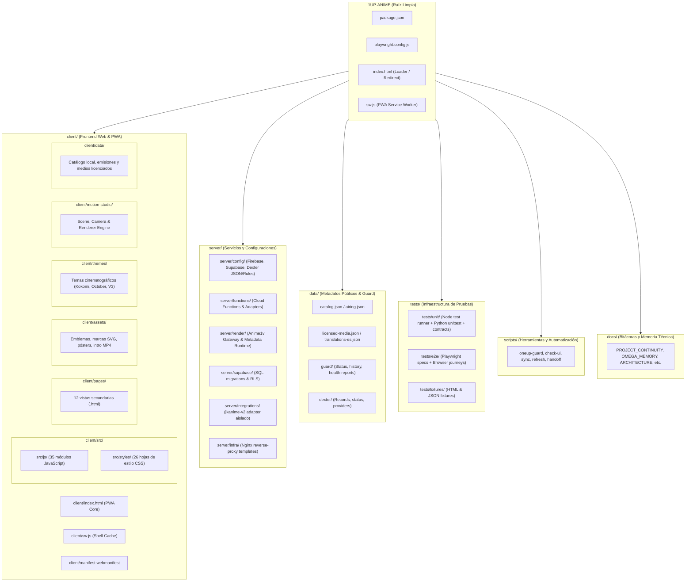

# Arquitectura y Organización de Contenedores · 1UP Anime

## 1. Visión General y Filosofía de Diseño

**1UP Anime** es una plataforma web y PWA mobile-first orientada a la curaduría editorial de anime en español, experiencia cinematográfica de alta fidelidad (motor DEXTER Motion), seguimiento de episodios y reproducción exclusiva de contenidos licenciados o de dominio verificado.

Siguiendo el estándar de arquitectura limpia establecido en proyectos hermanos (como `jkanime_app`), el repositorio se organiza en **contenedores modulares de primer nivel**, erradicando archivos sueltos en la raíz y delimitando claramente las responsabilidades entre el cliente frontend, los servicios backend/serverless, la persistencia de datos estáticos, la documentación, los scripts de mantenimiento y las suites de pruebas.

---

## 2. Diagrama de Arquitectura de Contenedores



---

## 3. Estructura de Directorios Detallada

```
1UP-ANIME/
├── .github/
│   └── workflows/              # 41 flujos de integración y entrega continua (CI/CD)
├── client/                     # Contenedor Frontend Web y Aplicación PWA
│   ├── assets/                 # Recursos gráficos originales (SVG, PNG, JPG, MP4 intro)
│   ├── data/                   # Copia local de catálogo y metadatos para el cliente
│   ├── motion-studio/          # Motor cinematográfico DEXTER (scene, camera, renderer)
│   ├── pages/                  # Vistas secundarias independientes:
│   │   ├── comunidad.html      # Foros, debates y actividad comunitaria
│   │   ├── dexter-motion-studio.html # Estudio de animación y renderizado de video
│   │   ├── gremio.html         # Portal de tripulaciones y gremios de fans
│   │   ├── moderacion.html     # Consola de supervisión editorial y reportes
│   │   ├── motor.html          # Panel de diagnóstico y métricas del motor
│   │   ├── preview-cinematic-v3.html # Experiencia cinematográfica V3
│   │   ├── preview-kokomi-mobile.html # Vista previa móvil Kokomi Studio
│   │   ├── preview-kokomi.html # Portada editorial alternativa Kokomi
│   │   ├── preview-october.html # Experiencia visual temática de octubre
│   │   ├── privacy.html        # Términos de servicio y política de privacidad
│   │   ├── scraping-lab.html   # Laboratorio de metadatos educativos
│   │   └── studio.html         # Espacio editorial de trabajo creativo
│   ├── src/
│   │   ├── js/                 # 35 módulos JavaScript frontend estructurados:
│   │   │   ├── studio.js       # Núcleo de catálogo, búsqueda y estado de la app
│   │   │   ├── auth.js         # Módulo de autenticación (invitado / federado)
│   │   │   ├── card-depth-engine.js # Motor de profundidad 2.5D en tarjetas
│   │   │   ├── depth-engine.js # Motor global de perspectiva y sombras
│   │   │   ├── depth-toggle-button.js # Control de alternancia de modo depth
│   │   │   ├── dexter-motion-engine.js # Motor de micro-interacciones cinematográficas
│   │   │   ├── episode-player.js # Reproductor modular multi-idioma (HLS / MP4)
│   │   │   ├── hls-adapter.js  # Adaptador de streaming adaptativo
│   │   │   ├── subtitle-studio.js # Renderizado de subtítulos estilizados
│   │   │   ├── anime-title-search.js # Búsqueda tolerante multi-idioma y alias
│   │   │   ├── premiere-hero.js # Hero dinámico de estrenos en emisión
│   │   │   ├── premiere-ranking.js # Algoritmo de ranking de estrenos
│   │   │   ├── airing-ui.js    # Calendario y programación de transmisiones
│   │   │   ├── official-watch.js # Integración con enlaces canónicos oficiales
│   │   │   ├── external-providers.js # Proveedores externos verificados
│   │   │   ├── anime1v-discovery.js # Adaptador cliente de descubrimiento Anime1v
│   │   │   ├── community.js    # Lógica de interacción social y comentarios
│   │   │   ├── episode-comments.js # Sistema de comentarios por episodio
│   │   │   ├── social-backend.js # Conector con backend social
│   │   │   ├── supabase-episode-backend.js # Conector opcional Supabase
│   │   │   └── franchise-explorer.mjs # Explorador visual de sagas y relaciones
│   │   └── styles/             # 26 hojas de estilo CSS modulares y optimizadas:
│   │       ├── studio.css      # Estilos base, diseño responsivo y cuadrícula
│   │       ├── motion.css      # Transiciones y motion design estándar
│   │       ├── spotlight.css   # Efecto spotlight dinámico de escritorio
│   │       ├── player.css      # Interfaz del reproductor de video
│   │       ├── subtitle-studio.css # Estilizado tipográfico de subtítulos
│   │       ├── anime-card-depth.css # Elevación y capas 2.5D de tarjetas
│   │       ├── depth-system.css # Sistema universal de profundidad
│   │       ├── depth-toggle.css # Componente visual del botón de profundidad
│   │       ├── dexter-motion-engine.css # Clases de animación fluida DEXTER
│   │       ├── brand-v2.css    # Identidad visual y paleta editorial
│   │       ├── premiere-hero.css # Carrusel y presentación de estrenos
│   │       ├── airing-ui.css   # Línea de tiempo de episodios
│   │       ├── community.css   # Muro y tarjetas comunitarias
│   │       └── ui-quality.css  # Reglas de accesibilidad y contraste
│   ├── themes/                 # Variaciones temáticas completas:
│   │   ├── cinematic-v3/       # Producción cinematográfica y capas 2.5D
│   │   ├── kokomi-mobile-preview/ # Diseño optimizado para Safari móvil
│   │   ├── kokomi-studio/      # Tema editorial Kokomi de alto contraste
│   │   ├── october-2026/       # Diseño estacional y sello arcano
│   │   ├── oneup-motion/       # Ventanas flotantes y animaciones
│   │   └── oneup-palette/      # Selector dinámico de paletas de color
│   ├── index.html              # Entrada principal de la aplicación PWA
│   ├── manifest.webmanifest    # Manifiesto PWA para instalación nativa
│   ├── robots.txt              # Directivas de indexación para buscadores
│   └── sw.js                   # Service Worker PWA con estrategia cache-first
├── server/                     # Contenedor Backend, Servicios y Configuraciones
│   ├── config/                 # Configuraciones seguras de infraestructura:
│   │   ├── firebase.json       # Configuración del CLI de Firebase
│   │   ├── firestore.indexes.json # Índices compuestos de Firestore
│   │   ├── firestore.rules     # Reglas de seguridad RLS de Firestore
│   │   ├── storage.rules       # Reglas de control de acceso a Cloud Storage
│   │   └── dexter-providers.json # Definición de proveedores de sincronización
│   ├── functions/              # Cloud Functions serverless (Node.js):
│   │   ├── index.js            # Punto de entrada de funciones serverless
│   │   ├── anime1v-adapter.js  # Adaptador restringido de solo metadatos
│   │   └── package.json        # Dependencias aisladas de funciones
│   ├── infra/                  # Plantillas de infraestructura y despliegue:
│   │   └── nginx/              # Configuraciones de servidor web reverso
│   ├── integrations/           # Integraciones con servicios externos aislados:
│   │   └── jkanime-v2/         # Paquete de consulta de metadatos aislado
│   ├── render/                 # Servicios de backend alojados en Render:
│   │   ├── anime1v-gateway.js  # Pasarela pública de solo metadatos
│   │   └── anime1v-source/     # Runtime aislado y auditado de Anime1v
│   └── supabase/               # Esquemas y migraciones de base de datos SQL:
│       └── sql/                # Scripts DDL con Row Level Security (RLS)
├── data/                       # Almacén de Datos Estáticos y Salud del Sistema
│   ├── airing.json             # Programación de emisiones sincronizada con AniList
│   ├── anime1v-config.json     # Estado y endpoint de la pasarela de metadatos
│   ├── catalog.json            # Catálogo estático principal de anime
│   ├── external-providers.json # Directorio de proveedores externos verificados
│   ├── licensed-media.json     # Catálogo de medios con derechos de reproducción
│   ├── translations-es.json    # Sinopsis traducidas al español neutro
│   ├── dexter/                 # Registros incrementales de DexterAnimeSync
│   └── guard/                  # Reportes persistentes del motor de auto-recuperación
├── docs/                       # Documentación Técnica, Decisiones y Bitácoras
│   ├── ARCHITECTURE.md         # Este documento de arquitectura
│   ├── PROJECT_CONTINUITY.md   # Bitácora continua de desarrollo y estado
│   ├── OMEGA_MEMORY.md         # Memoria de ingeniería y decisiones persistentes
│   ├── OMEGA_NEXT_ACTIONS.md   # Plan de acción y próximas tareas priorizadas
│   ├── NEW_CHAT_HANDOFF.md     # Ficha de traspaso automático entre sesiones
│   └── ...                     # Guías operativas, setup de Firebase y auditorías
├── scripts/                    # Scripts de Automatización y Tareas de Mantenimiento
│   ├── check-guard.mjs         # Validador de esquemas de salud del sistema
│   ├── check-resilience.mjs    # Pruebas de resiliencia ante cortes de red
│   ├── check-supabase-option.mjs # Verificación de configuración opcional Supabase
│   ├── check-ui.mjs            # Auditoría contractual de la interfaz de usuario
│   ├── dexter-anime-sync.mjs   # Motor de sincronización incremental de fuentes
│   ├── oneup-guard.mjs         # Motor guardián de auto-recuperación y monitoreo
│   ├── refresh-airing.mjs      # Refresco programado de horarios de emisión
│   ├── refresh-catalog.mjs     # Generador de instantáneas del catálogo AniList
│   ├── render-motion-studio.mjs # Renderizador Full HD (MP4/H.264/AAC)
│   ├── serve-client.mjs        # Servidor estático ligero para pruebas locales
│   └── update-new-chat-handoff.mjs # Generador determinista de traspaso
├── tests/                      # Suite Completa de Pruebas de Calidad (QA)
│   ├── e2e/                    # Pruebas de extremo a extremo con navegador:
│   │   ├── depth-mode.spec.js  # Validación de capas de profundidad en viewport
│   │   ├── e2e-browser.mjs     # Recorridos completos en resolución móvil y desktop
│   │   ├── e2e-franchise.mjs   # Navegación interactiva por relaciones de series
│   │   ├── e2e-kokomi-preview.mjs # Pruebas de interfaz Kokomi y audio AAC
│   │   ├── e2e-motion-studio.mjs # Renderizado visual de escenas cinematográficas
│   │   ├── e2e-oneup-finale.mjs # Recorridos del diseño editorial final
│   │   ├── e2e-player-languages.mjs # Pruebas de selección de idioma y subtítulos
│   │   ├── premiere-hero.spec.js # Pruebas de interacción con carrusel de estrenos
│   │   └── site-quality.spec.js # Verificación de contraste, modales y accesibilidad
│   ├── fixtures/               # Archivos estáticos de prueba (HTML, JSON)
│   └── unit/                   # Pruebas unitarias de aislamiento:
│       ├── *.test.mjs          # Pruebas de Node Test Runner (búsqueda, motion, etc.)
│       ├── test-*.mjs          # Verificación de contratos, carrera y reproductores
│       └── test_*.py           # Pruebas unitarias en Python (scrapers, hermes, etc.)
├── index.html                  # Cargador raíz con redirección instantánea a client/
├── sw.js                       # Proxy de service worker en raíz
├── package.json                # Configuración de scripts unificados de prueba
├── playwright.config.js        # Configuración del ejecutor de pruebas de navegador
└── README.md                   # Resumen del proyecto y comandos de inicio
```

---

## 4. Comandos Unificados de Desarrollo y Verificación

Alineado con las directrices del proyecto y el flujo estándar de `npm`, se proporcionan los siguientes comandos en la raíz:

| Comando | Acción Realizada |
| :--- | :--- |
| `npm test` | Ejecuta las **40 pruebas unitarias** de JavaScript con el Node Test Runner (`node --test`). |
| `npm run test:unit` | Alias de `npm test` para pruebas unitarias. |
| `npm run test:python` | Ejecuta las **16 pruebas unitarias** en Python (`python -m unittest discover tests`). |
| `npm run test:ui` | Ejecuta las **152 aserciones contractuales** de interfaz (`node scripts/check-ui.mjs`). |
| `npm run test:guard` | Ejecuta la auditoría completa de los **48 puntos de salud** del sistema en modo offline. |
| `npm run test:all` | Ejecuta la suite completa de calidad (unitarias JS + Python + UI + Guard) en secuencia estricta. |
| `npm run test:depth` | Ejecuta las pruebas Playwright del motor de profundidad 2.5D. |
| `npm run sync:dexter` | Ejecuta el motor incremental de sincronización `DexterAnimeSync`. |
| `npm run refresh:catalog` | Refresca el catálogo público desde GraphQL AniList. |
| `npm run refresh:airing` | Refresca los horarios de transmisión y estrenos. |
| `npm run handoff` | Regenera la ficha de traspaso técnico para nuevas sesiones (`docs/NEW_CHAT_HANDOFF.md`). |

---

## 5. Garantías de Calidad y Preservación de Estilo

1. **Cero Alteración Visual**: Todo el diseño editorial, la paleta de colores Kokomi/1UP, las animaciones DEXTER Motion, las capas 2.5D de profundidad y los componentes interactivos se preservan con absoluta exactitud.
2. **PWA Mobile-First**: Compatibilidad garantizada para iPhone y Safari sin obligar a inicio de sesión ni requerir permisos bloqueantes.
3. **Presupuesto Cero**: Ninguna dependencia comercial ni servicios de pago añadidos.
4. **Reproducción Verificable**: Se mantiene el principio de no simular ni inventar streams de video; solo se utilizan fuentes autorizadas y metadatos públicos verificables.
